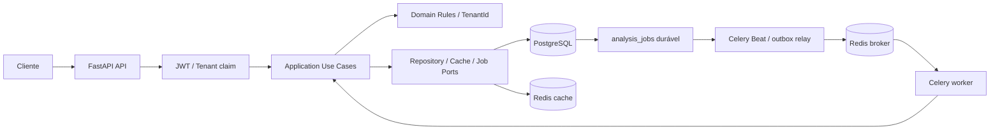

# SerenaERP

## Visão geral executiva

SerenaERP é uma plataforma GovTech multi-tenant para gestão e análise de
licitações públicas municipais. O repositório implementa um monólito modular
em Python, com API HTTP, persistência PostgreSQL, cache Redis e processamento
assíncrono Celery. A infraestrutura Terraform descreve um alvo AWS com ECS
Fargate, RDS, ElastiCache e Cognito; ela não é evidência de uma conta de
produção já provisionada.

O foco da arquitetura é previsibilidade: uma licitação pertence a um tenant,
uma análise assíncrona nasce em uma transação durável e Redis acelera ou
transporta trabalho, mas não é fonte de verdade de negócio.

## Destaques de arquitetura e engenharia

### Clean Architecture e DDD

- `app/domain` contém entidades, `TenantId`, estados e contratos abstratos.
- `app/application` orquestra casos de uso por portas, sem FastAPI,
  SQLAlchemy, Pydantic, Celery, Redis ou AWS SDK.
- `app/api`, `app/infrastructure` e `app/workers` são adaptadores de borda.
- `tests/test_architecture.py` percorre recursivamente domínio e aplicação por
  AST e bloqueia imports de frameworks ou camadas externas.

### Isolamento multi-tenant

O claim Cognito `custom:tenant_id` deve coincidir com `X-Tenant-ID` antes de
qualquer caso de uso. O domínio transporta o identificador como `TenantId`,
repositórios aplicam predicados de tenant e o banco reforça o modelo com chave
de negócio `UNIQUE (tenant_id, numero)` e uma FK composta que impede um job de
análise de apontar para uma licitação de outro tenant. UUID conhecido não é
autorização.

PostgreSQL Row Level Security ainda não é usado; veja os trade-offs e o risco
residual em [Architecture](docs/ARCHITECTURE.md) e na
[ADR de isolamento](docs/adr/0001-multi-tenant-isolation.md).

### Processamento assíncrono recuperável

Solicitar análise grava, na mesma transação PostgreSQL, a mudança de estado e
um `analysis_job` tenant-bound. A API não faz I/O de broker no caminho da
requisição: o Celery Beat relê o registro confirmado e publica-o. Uma
lease/token de relay persistida impede publicação concorrente normal, e o
worker possui uma lease de execução/token independente para tornar reentrega
segura.

O modelo é **at-least-once**, não exactly-once. O efeito atual de IA é uma
simulação local; um provedor LLM futuro deve aceitar `job_id` como chave de
idempotência antes de produzir efeito externo.

### Infraestrutura e FinOps

O Terraform define rede privada, ECS Fargate, RDS, ElastiCache, Secrets
Manager/KMS, Cognito, ALB TLS e budgets opcionais. Staging e produção têm
sizing distinto. As configurações são um ponto de partida: autoscaling do
worker ainda é orientado a CPU, não a idade/profundidade da fila, e requer
métricas antes de qualquer ajuste operacional.

## Evidências de qualidade

Na validação local containerizada mais recente, executada com Python 3.11,
PostgreSQL e Redis, a suíte passou **21/21**. Ela cobre arquitetura,
autenticação, isolamento cross-tenant, constraints tenant-aware, outbox,
reentrega, cache indisponível e contrato PostgreSQL real.

O repositório oferece um cenário Locust, mas não contém uma execução auditável
que sustente números de p50, concorrência ou taxa de erro. Não publique
métricas de desempenho antes de anexar uma execução reproduzível com ambiente,
duração, volume de dados e relatório.

## Executar localmente

Pré-requisito: Docker Desktop com engine Linux ativo.

```bash
docker compose up -d --build
docker compose exec -T app alembic current --check-heads
docker compose exec -T app pytest -v
```

O serviço `migrate` já aplica `alembic upgrade head` antes de API, worker e
Beat. O comando manual de `upgrade` é idempotente se uma confirmação adicional
for necessária.

Em desenvolvimento, use o tenant seed e o bypass explicitamente local:

```bash
curl -X POST http://localhost:8000/api/v1/licitacoes/ \
  -H "Authorization: Bearer dev-token" \
  -H "X-Tenant-ID: 00000000-0000-0000-0000-000000000001" \
  -H "Content-Type: application/json" \
  -d '{"numero":"PE-LOCAL-001","descricao":"Compra de equipamentos","valor_estimado":"1000.00"}'
```

`Bearer dev-token` só é aceito quando `ENVIRONMENT=development`. O default da
aplicação é `production`; staging e produção exigem JWT Cognito válido.

Para o smoke test completo (CRUD, job e logs), consulte o
[Runbook](docs/RUNBOOK.md).

## Fluxo de arquitetura



## Segurança e operação

- `.env`, bancos locais, logs, caches, ambientes virtuais, certificados e
  estado Terraform são ignorados por Git e pelo contexto Docker.
- O runtime executa como usuário não-root; uma imagem padrão `docker build .`
  termina no estágio de produção. Compose seleciona o estágio de desenvolvimento
  somente para a API local que executa testes.
- Não há garantia de segredo para valores de exemplo locais (`goverp/goverp`);
  eles não devem ser reutilizados fora do Docker local.
- Os serviços locais publicados pelo Compose são vinculados a `127.0.0.1`, não
  à rede local; use um override explícito e autenticado se precisar expô-los.
- Antes de deploy público, configure backend remoto Terraform cifrado e com
  acesso restrito, execute plano revisado, teste Cognito real e configure
  alarmes, retenção de logs e métricas de fila.

Documentação complementar:

- [Arquitetura](docs/ARCHITECTURE.md)
- [Segurança](docs/SECURITY.md)
- [Runbook operacional](docs/RUNBOOK.md)
- [Hardening e riscos](docs/architecture-hardening.md)
- [ADRs](docs/adr)
